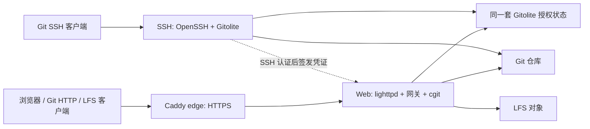

> 当前实现已迁移到 Go，源码与验证边界见 [GO-RUNTIME.md](GO-RUNTIME.md)。本文保留为历史规划，其中环境和 CI 描述不作为当前事实。

# 轻量 cgit 一体化托管方案

日期：2026-10-31。状态：规划草案，待审阅；不是已实现功能或部署记录。

安全是每阶段的基础验收要求，详见 [安全设计与验收](SECURITY-DESIGN.md)。覆盖入口、授权、SSH、秘密、恶意内容、自动化、备份、容器和供应链；规划不代表已安全验收。

语言路线已按用户要求确定为：**先用 Python 验证完整最小方案，再全面迁移本项目 runtime 到 Go**。GitHub Actions 承担独立契约、Linux 镜像/Compose、安全与恢复验证；详细范围和阶段见 [Runtime 迁移与 CI 计划](RUNTIME-MIGRATION-AND-CI.md)。

## 1. 目标与推荐结论

为个人长期托管、备份、公开分享和少量协作者提供一套 Compose 应用。用户准备数据目录、域名/访问地址、自己的公钥和必要凭证后，统一启动、检查、升级和恢复；不依赖宿主机的 SSH、Git、Nginx 或 Caddy 服务。

推荐采用 **一个 Compose 项目、三个托管服务，加一个可按需启用的任务服务**：

1. `edge`：官方 Caddy 镜像，公网 HTTPS 和反向代理。
2. `web`：本项目应用镜像，lighttpd + cgit + runtime 网关，负责网页、Git HTTP 和 LFS；Python 为验证阶段，最终使用 Go。
3. `ssh`：同一个应用镜像的 SSH 启动角色，OpenSSH + Git + Gitolite，负责公钥访问和 LFS 认证。
4. `maintenance`：定时同步、检查、打包/版本化备份和受控维护；启用自动化时运行，不依赖宿主机 cron。使用本仓库提供的独立任务镜像，避免把备份工具加入 Web/SSH 镜像。

托管部分仍是两个镜像；启用 maintenance 时增加一个任务镜像，最多四个常驻服务。任务调度和备份是本次明确纳入的产品能力，不再只留作未来扩展。

权限后端优先推荐 Gitolite；它与现有网关的连接必须先做可行性验证。此处选择推荐路线，不假定现有代码已支持它，也不在未验证时悄悄改成自写另一套授权系统。

不新增数据库、Redis、对象存储、注册平台、组织、PR/Issue、自建 CI 平台或网页管理后台；本项目开发验证使用 GitHub Actions。保留当前 linux/amd64 支持范围，不为这轮规划增加架构支持。首次配置和日常管理使用少量容器内命令。

这里的“一体化”是同一套部署、配置、权限和数据管理，不是所有进程挤进同一个容器。只有容器数量不同，并不等于资源消耗更大或更小；本方案尚无资源基准。

## 2. 当前项目基线和缺口

| 事项 | 当前代码/工作区 | 目标 |
|---|---|---|
| 网页 | cgit v1.3.1 + lighttpd | 保留 |
| 配置 | 启动生成 runtime cgitrc/settings | 扩展为统一、可校验的配置 |
| Runtime 语言 | 7 个自有 Python 模块及上游 Python 高亮调用 | 全部自有运行逻辑/过滤器转 Go，运行镜像无 Python 依赖 |
| Git HTTP | 官方 git-http-backend，支持浅克隆及可选认证 push | 保留，接入逐人逐仓库授权和写入 hooks |
| SSH | 镜像未包含服务，文档依赖宿主机 | 由 Compose 内 SSH 服务提供 |
| HTTP 身份 | 单账号，全站 public/private | 每人独立身份与凭证 |
| 仓库可见性 | 全站模式加隐藏/排除规则 | 同一实例公开/私有混合，默认拒绝 |
| LFS | 容器内 HTTP Basic transfer，SHA-256、Range、网页提示 | 沿用存储和接口，接入统一权限与 SSH 认证 |
| HTTPS | 由外层入口负责 | Compose 提供 Caddy；也能接现有入口 |
| 检查 | doctor、协议测试、发布前容器测试定义 | 增加权限矩阵、SSH、恢复和代理验收 |
| 自动化 | 无任务调度服务 | 定时/手动执行同步、检查、打包和备份，可查看上次结果 |
| 安全 | 已有部分认证/路径/内容防护，无完整目标架构验收 | 落实安全设计 S01–S08 和公网试点 G1–G8 |
| 数据 | repos/lfs/cache/secrets | 保留 Git/LFS 路径，补权限状态与主机密钥 |

工作区已有上一阶段未提交的功能修复、统计精简和维护文档，必须保留，不视为新的规划实现。上轮本地协议结果为 31 项中 29 通过、2 跳过；这不是本轮新跑的测试，也不能证明目标架构。当前机器无 Docker，尚无本轮容器、NAS 或 VPS 验证。

本轮只修改规划和文档入口；不改 Dockerfile、Compose、运行代码、仓库配置、数据或远端服务。

## 3. 为什么选这个结构

| 结构 | 取舍 | 结论 |
|---|---|---|
| 单容器装入 Caddy、lighttpd、sshd | 需要进程监管、组合健康检查和信号处理；更新/故障耦合 | 可做，但不作为首版并行维护的第二套实现 |
| Caddy + Web/SSH 合并容器 | 两个服务，但应用容器仍需多进程管理 | 只有明确的部署限制时再考虑 |
| Caddy + Web + SSH | 每个容器一个前台主服务；Web/SSH 复用镜像和数据 | 推荐 |

任务调度独立为可选 maintenance 服务；不在 Web 或 SSH 里偷偷启动 cron。用户不开自动化时不产生调度进程，启用后与其他服务一起由 Compose 管理。

保留 lighttpd，因为目前的 CGI 路由、流式传输和压缩已围绕它实现。Caddy 管理 HTTPS；Python 先承担功能验证，Go 迁移先保持 CGI/传输结构，避免把换语言与换 Web 承载方式同时进行。最终 Go 是用户已确定的交付方向，不再以“暂留 Python、以后再决定是否重写”为目标。

Gitolite 增加 Perl 和配置/hook 管理成本，但已有公钥身份、仓库授权、写入与强推检查，也提供外部查询接口。相较新写一套 SSH 权限系统，优先复用它。它不会自动替 cgit 或 LFS 完成鉴权，适配层仍是本项目需要维护和测试的代码。

## 4. 访问路径和网络



- VPS 自建分享：启用 edge，仅发布 HTTPS/证书验证所需入口及独立 Git SSH 端口，Web 后端不直接映射公网。
- HomeNAS：复用同一应用与权限模型。已有 HTTPS 入口时不启用 edge；只读本地调试入口只绑定回环地址。HTTP 明文仅限明确可信/隔离场景，不自动把 Basic 凭证暴露到不可信网络。
- 基础服务 web/ssh 始终由 Compose 管理；edge 用可选 profile 或小型部署覆盖文件启用。实施时二选一，不堆多套等价启动方式。
- maintenance 使用可选任务 profile；只允许访问配置中指定的同步源/目标及备份目的地，不开放公网任务接口。
- SSH 不经过 Caddy 的普通 HTTP 代理，单独发布端口；不能占用/修改宿主机现有管理 SSH。具体端口在部署时选，不在规划中写死。
- 使用域名根路径；沿用显式 CGIT_BASE_URL/SSH clone 地址，不在本轮支持子路径部署。
- Caddy 内部连接 web，透传 Authorization 与 Range；不注入可被客户端伪造的身份头，不缓存私有内容，不重复 gzip 已由后端压缩的响应。
- 公网自动证书依赖域名验证条件和出站 ACME 请求，证书状态必须持久化。因此不能再把“整套运行时完全不出站”作为公网 TLS 模式的承诺；仓库读取不按需回源。

这规划的是用户提出的自建 VPS 分享能力，不预设其与 HomeNAS 同时部署两套实例，也不预先选择 GitHub 等第三方同步目标。只有明确配置并启用的任务才会同步；哪些仓库放到哪个部署仍由所有者决定。

## 5. 人员、公开范围与权限

人员身份与 Linux 用户分开：每个自然人一个稳定用户名，多把设备公钥可属于同一个人；容器使用统一 Git 系统账号执行受限操作。HTTP 凭证也属于这个稳定用户名。

| 身份/仓库授权 | 公开仓库读 | 私有仓库读 | Git push / LFS upload | 管理权限与仓库 |
|---|---|---|---|---|
| 匿名访客 | 允许 | 拒绝 | 拒绝 | 拒绝 |
| 普通登记人员，未获授权 | 允许 | 拒绝 | 拒绝 | 拒绝 |
| 指定仓库只读 | 允许 | 仅指定仓库 | 拒绝 | 拒绝 |
| 指定仓库读写 | 允许 | 仅指定仓库 | 仅指定仓库 | 拒绝 |
| 所有者 | 允许 | 全部业务仓库 | 全部业务仓库 | 管理命令/管理配置 |

建议默认：

- 新建/迁入仓库先私有；没有规则或配置错误时拒绝访问。旧 public 模式不自动转换成所有仓库 public。
- 公开是匿名读取授权，不是匿名写入。公开状态可以与只允许指定人员写入同时存在。
- 协作者只授予 `RW`，日常快进推送；是否给所有者 `RW+`（强推/删除分支标签）在实施前确认。不给普通协作者隐含的强推权限。
- 首版只提供仓库级授权，不提供私有分支、文件级读隔离或 Forgejo 式受保护分支流程。能读取仓库就应视为能读取仓库完整可获取历史，不用隐藏 refs 代替机密隔离。
- 仓库删除、改名、人员授权和凭证重置仅由所有者管理。首版不允许协作者自动建库、删除仓库或上传可执行 hooks。
- 管理仓库及内部状态永不出现在 cgit/公共 HTTP/LFS 列表；即使业务仓库公开，也不能让通配规则误公开管理数据。

`cgit.hide` 继续只负责列表展示；`cgit.ignore`、`noweb` 等排除措施与 ACL 取交集，不能当作 public/private 的唯一权威。需用适配层使这些全局禁用措施在 SSH、HTTP、LFS 和网页保持一致。

## 6. 配置权威与生效方式

首版推荐沿用 Gitolite 原生 `gitolite.conf + keydir` 作为人员/仓库授权来源，不同时维护一份自定义 ACL 和一份可独立修改的 Gitolite ACL。

- 对外提供少量管理命令，先展示差异再 apply；具体 CLI 名称尚未实现。命令内部校验并更新权威配置，不要求日常手写复杂 Gitolite 规则。
- HTTP 凭证单独保存，只负责“这个人是谁”，不能独立授予仓库权限。只允许绑定到已登记、未禁用的身份；匿名保留身份不可配置公钥或 HTTP 凭证。
- 公开仓库规则在同一权威配置内明确表示，编译后应让匿名和所有有效用户都能读；不能仅让未登录访问成功，却让已登录的普通用户读公开仓库失败。
- 源配置、编译状态、authorized_keys 和策略 generation 配套管理。apply 时停止接收新写入/短暂进入维护状态，校验成功后开放，避免一部分进程使用新权限、另一部分使用旧权限。
- 初版不要求无停机热更新。可靠的检查、受控 apply 与一致的撤权优先于复杂的在线刷新。
- 原子替换、持久化和失败回退必须验证；挂载策略目录而非单个被替换的文件，避免容器一直看到旧 inode。编译目录不作为可自由编辑的第二份来源。
- 不用环境变量携带全部用户名、密码和公钥，也不把凭证放 Git remote URL、镜像层或访问日志里。

建议 HTTP 首版使用每人一个高熵随机访问凭证（Git credential helper 可保存），浏览器通过 HTTPS Basic 登录；服务端只保存合适的哈希校验值。具体库、成本参数及凭证轮换命令在实施时验证，不自行设计密码学。Basic 没有完善的浏览器退出体验，这是首版取舍；若确需常用网页登录/退出，再单独规划会话系统，不顺手加入 SSO。

建议初始化：所有者准备公钥、初始化身份及 HTTP 凭证，显式 apply，再启动正式入口。没有有效所有者配置时拒绝启动，不自动创建默认密码或匿名可写服务。

## 7. 各入口如何执行同一权限

### SSH

OpenSSH 做公钥认证，Gitolite 做受限 Git 命令与授权。必须使用 forced command，禁用交互 shell、PTY、agent/X11/端口转发和任意命令。一个人只拥有其被授权仓库访问能力，不获得服务器账号权限。

适配层只允许已验证的 Git 读取/写入操作及 LFS 认证命令；路径用仓库逻辑名映射，不接受任意服务器文件路径、符号链接逃逸或 shell 拼接。Gitolite 扩展命令采用白名单，不开放与个人场景无关的 fork、脚本运行或权限自助管理能力。

### Git HTTP

网关验证个人凭证，清除不可信的 REMOTE_USER/GL_* 等身份来源，再把可信身份交给 Gitolite HTTP 入口，由其连接官方 git-http-backend。不能只检查一次“允许写入”，然后继续用当前直接 exec 后端的路径跳过 Gitolite 的更新 hook。

公开 clone/fetch 不需凭证；私有读取和全部写入要求认证。HTTP push 推荐继续保持显式开关；开启后也必须通过仓库和 refs 的检查，不能绕过 SSH 的强推策略。是否默认只用 SSH 写入，留作部署偏好，不删除现有 HTTP push 能力。

### 网页与归档

网关先计算该身份可见仓库，再用上游 cgit 支持的 project-list/受控配置生成其浏览范围。列表、搜索、分类计数、Atom、README、tree、log、diff、patch、blame、归档和 `?r=`/`?url=` 旧入口都只接触授权仓库。

必须同时限制仓库列表和直接请求，不能把名单仅当菜单隐藏。生成文件位于不可通过 Web 读取的私有临时目录；用户/请求之间不共享一个可覆盖的配置文件。过滤器接收网关设置的可信身份上下文，不能因 README/LFS filter 再次按匿名身份查库而误拒绝或越权。

### LFS

读取 ACL 控制 Batch download、对象 GET/HEAD/Range、raw、README 图片与预览；写入 ACL 控制 Batch upload、PUT、verify。知道对象 SHA-256 不能越过仓库权限。LFS 对象仍按仓库隔离。

对象是否仍被 Git refs 引用，不属于首版授权判断：有仓库读权限者能按 OID 获取该库内遗留对象。公开之前必须审查历史与 LFS 实体；不承诺撤回已经被他人克隆的数据。

## 8. SSH 与 LFS 的衔接

保留现有 HTTP Batch + Basic transfer，在 SSH 入口增加官方约定的 `git-lfs-authenticate <repo> upload|download`：

1. 通过 SSH 公钥识别人员/设备。
2. 按同一 ACL 验证指定仓库和操作。
3. 返回明确 HTTPS 地址、Authorization 短期凭证和到期信息。
4. 客户端通过 HTTPS 访问 Batch 和对象 action；action 所需认证必须继续传递，不能只保护首个 Batch。

短期凭证限定部署、身份、来源公钥、仓库、读/写操作和权限 generation；到期或撤销人员/公钥/权限后，新请求拒绝。使用成熟库/标准签名机制，不使用裸用户 ID 作为凭证，不允许客户端自行决定签名算法或权限字段。

撤权承诺针对后续请求及新的 SSH 命令；已开始的 clone/下载/推送不会因为改配置就必然自动终止。紧急撤权时需要额外关闭会话/停止相关服务，并在文档中说明，不能宣称有“即时收回已下载数据”的能力。

这是 SSH 认证 + HTTPS LFS 传输，不是纯 SSH LFS transport。客户端仍需 Git LFS；纯 SSH 传输、LFS 锁、自动 GC、对象跨仓库去重和归档展开不在首版范围。

## 9. 数据、挂载和信任边界

建议布局（保持旧数据路径，新增目录具体名字可调整）：

```text
repos/             业务 bare 仓库，保留现有 group/name.git
lfs/               保留现有每仓库对象布局
access/            权威管理配置、公钥、Gitolite 状态与 hook 管理信息
secrets/           HTTP 凭证校验状态、token 签名秘密等
ssh-host-keys/     SSH 主机私钥，重建容器不改变指纹
caddy-data/        公网证书与 ACME 状态
cache/             Web 临时配置、静态压缩缓存、上传缓冲、日志
backups/           本地备份暂存，不视为独立灾备位置
jobs/              调度及任务声明，不存明文秘密
job-state/         上次执行、成功/失败、锁和完成清单
job-work/          外部同步和备份的一致性暂存区，不直接作为公开仓库扫描
```

| 服务 | Git 仓库 | LFS | 权限状态 | 其他秘密 |
|---|---|---|---|---|
| edge | 不挂载 | 不挂载 | 不挂载 | 只访问自己的 TLS 状态 |
| web | HTTP push 关闭时只读；开启时按需可写 | 提供上传时可写 | 读取已编译授权，不任意修改来源 | HTTP 校验状态、LFS 凭证验证所需内容 |
| ssh | 可写 | 不必挂载对象目录 | 读取授权和公钥；管理更新独立执行 | SSH 主机私钥、LFS 签发所需内容 |
| 一次性管理命令 | 按建库/迁移需要 | 仅改名/恢复等需要 | 可写 | 按具体命令最小提供 |
| maintenance | 只读检查/备份，或指定任务管理仓库的可写操作 | 只读备份，迁入对象时受控写入 | 读取授权；不自行授予公开/协作者权限 | 仅任务所需出站凭证和备份凭证，无 SSH 主机私钥 |

Gitolite 某些命令需要写自己的日志/运行文件；实施时把这些路径与编译授权目录分开验证，不把“权限配置只读”简单理解为整个 Gitolite home 全部只读。

服务使用匹配的 UID/GID 访问共享仓库；不对每个协作者创建系统用户。SSH 的权限下降、capabilities、主机密钥读取方式在容器里实际验证，不盲目照搬当前 web 的 cap_drop/cap_add。

多个服务访问同一个存储，不是多个仓库副本。备份、Git GC、权限 apply、迁移等写操作必须有维护锁/明确顺序。管理员与服务进程仍属于信任边界；这不是防御容器逃逸或应用进程被完全攻陷的多租户隔离系统。

任务服务属于管理员信任边界。只读备份与可写同步使用不同的执行权限/挂载入口；最终能否在同一任务服务内可靠隔离，要在实施中验证。若启用任意维护脚本，则必须明确其能访问的全部挂载，不能把应用层路径白名单宣传成操作系统级隔离。

## 10. 个人日常工作流

以下命令名称只描述目标接口，尚未实现；不提供可误以为现在能执行的启动脚本。

| 事情 | 期望操作 | 默认结果 |
|---|---|---|
| 第一次部署 | 初始化所有者、公钥、访问地址和持久目录 | 无弱默认密码、无自动公开 |
| 新建仓库 | 容器管理命令建库并设置默认分支 | 私有，仅所有者可读写 |
| 邀请协作者 | 登记身份/公钥，授予具体仓库 R 或 RW，apply | 不自动获得其他私有库 |
| 公开分享 | 查看发布差异，显式授予匿名 R | 匿名不能 push 或上传 LFS |
| 收回访问 | 删除指定授权或禁用人员/设备公钥，apply | 后续 SSH/HTTP/LFS 请求拒绝 |
| 改名/分类迁移 | 维护命令成对处理 Git/LFS、授权和 URL | 不只 mv 一个 Git 目录 |
| 删库 | 先备份、停止写入、归档/隔离，明确确认后删除 | 不自动删库或 LFS GC |
| 换域名/端口 | 更新显式访问地址与证书入口，核对 clone/LFS URL | 不改 Git 提交历史 |
| 设置自动化 | 登记任务类型、仓库/目的地、频率和独立凭证 | 默认禁用，校验并启用后执行 |
| 临时执行/排错 | 手动运行同一任务，查看状态和日志 | 与定时执行共用权限、锁和工作流 |

只有管理 Git 服务的命令需要 `docker compose exec/run`；日常开发者继续普通 git clone/fetch/push，不必知道底层服务如何拆分。

## 11. 浏览与性能策略

保留 README、高亮、分支标签、历史、提交图、diff、blame、提交搜索、Atom 和 ZIP/tar.gz；不加全文索引、外部头像、统计面板或大型预览服务。分类/名称排序和现有 512 KiB blob 展示限制先沿用；默认统计关闭。

页面缓存继续关闭，动态响应 no-store，静态文件保留压缩缓存。即使固定 commit，LFS 可用性和当前权限也会变化；后续缓存设计必须同时考虑身份、授权 generation、LFS 状态，不能只按 URL 缓存。

沿用普通 HTML 缓冲压缩、Git/LFS/raw/archive 按路径流式传输。归档实时生成，LFS 不展开；cgit 某些 Git blob 读取仍有内存开销，不能把 HTTP 流式发送宣传成所有层都恒定内存。

初版授权查询不设长期常驻、无法感知权限变化的缓存。可先按请求使用 Gitolite 批量查询减少多次启动，但批处理作用域限制在请求内；长生命周期查询进程必须在配置变化时重启/失效。

保留现有超时、LFS 大小上限作为兼容基线，在设计中不认定它们是最佳值。后续将 Git 请求体上限、单个 LFS 对象上限、上传临时空间区分清楚；不在没有文件规模和带宽证据时调整。

记录空闲与克隆/推送/LFS/大历史页面时的 RSS、CPU、磁盘临时空间、响应时间及错误。使用相同机器和合成仓库比较 Python 参考与 Go 实现；语言迁移方向已定，但性能收益、资源限制和是否进一步改常驻服务仍以测量为依据。

## 12. 健康、日志与升级

- 分开检查 edge 的 HTTPS 入口、web 的动态配置/后端可用、ssh 的配置和监听；外部验收必须真实认证 clone，而不只检查端口打开。
- 静态 CSS 的镜像 HEALTHCHECK 只算存活；不能证明 SSH、ACL 或仓库完整。健康检查允许空仓库集合，不包含昂贵的全量 fsck/hash。
- Docker 标记 unhealthy 不等于自动重启；进程退出的 restart 策略、启动依赖及持续健康告警要分别说明，不靠 depends_on 假设永久可用。
- 访问/授权日志记录身份、仓库、操作、结果、策略 generation；不记录密码、Authorization、短期 token 或大段原始请求。HTTP、SSH 和容器日志都要有界轮转，具体保留量按部署磁盘选择。
- 公网入口不加复杂 WAF 系统；对未认证请求、并发上传和凭证尝试设置可测的保护，并按实际流量决定参数，防止新适配代码引入无限请求/进程/临时文件堆积。
- 应用镜像固定 cgit 提交和配套 Git 版本，新引入 Gitolite/OpenSSH/Caddy 选已验证版本/镜像 digest，并纳入安全更新。确认不支持的基础镜像版本时另行安排升级，不把现有版本永远固定。
- 先构建和测试再发布，部署引用 digest。保留上一版镜像、配置和一致性备份；镜像回退不等于回退数据或权限状态。

## 13. 备份、恢复与迁移

备份和定时自动化均作为首版能力：一次性命令和 maintenance 调度调用同一套工作流。自动化按用户配置启用；目标位置、加密、保留版本、频率和提醒渠道尚未决定，不能只加定时器却没有独立备份目的地。

### 13.1 任务范围和工具选择

maintenance 推荐采用容器调度器 Supercronic + 受控任务执行器；具体版本固定后验证时区、信号与退出行为。备份后端优先评估 restic，保留用户要求的归档打包模式。Git/Git LFS 负责仓库与对象同步，已有 doctor 负责完整性检查；不另外搭建通用 CI/工作流平台。

| 任务类型 | 做什么 | 必要边界 |
|---|---|---|
| `sync-in` | 从明确的远端定时获取仓库和所需 LFS | 只能写入专门登记的拉取型仓库，不能覆盖协作仓库 |
| `sync-out` | 将指定本地仓库推送到明确远端 | 单独启用、逐目标授权，先预览更新，不默认 mirror push |
| `check` | Git fsck、LFS 指针/实体完整性检查 | 频率独立于日常同步，不能每次网页健康检查都全盘扫描 |
| `archive` | 生成带日期/任务 ID、清单与校验值的归档 | 不等于 cgit 的源码 ZIP；完整恢复须包含 Git、LFS 及必要配置/秘密 |
| `backup` | 保存版本化备份到独立目的地 | 加密、保留策略与恢复验证必须配套 |
| `maintenance` | 执行管理员登记的本地维护脚本 | 明确脚本、参数、挂载和凭证，不执行仓库里拉来的代码 |

这是受控的个人任务功能，不提供协作者提交任意任务/脚本的权限。自定义脚本由管理员放在单独只读脚本目录，不从仓库 hooks、README 或网页输入生成 shell 命令。

建议首版先完成 sync-in、archive/backup、check；sync-out 和自定义脚本能力在相同任务机制验证后交付。同步动作是否启用及其远端名单，由所有者逐项确认，不自动发布到第三方平台。

### 13.2 仓库同步语义

严格区分：

- **协作仓库**：自己和协作者日常 push 的主仓库，不允许定时任务从其他地方强行覆盖它的同名 refs。
- **拉取型仓库**：声明远端为权威，供本地浏览/留存；普通 SSH/HTTP 用户不能向其 push，只有相应管理任务能更新。
- **对外同步目标**：显式声明的远端，使用独立最小权限凭证；目标是发布/同步，不是自动获得备份能力。

默认推荐安全更新：在私有工作区获取远端 refs，先识别新增、快进、删除与历史改写；只允许已配置的正常更新。远端删除或非快进变化进入冲突/待处理状态，保留现有 refs；严格镜像模式须单独明确允许传播删除/改写。两者不能共用一个含糊的“同步”开关。

真正的 `--mirror` 会改变 refs 映射，后续更新可覆盖本地 refs；带 prune 的同步还能传播删除。不能在协作仓库上直接套用 clone/fetch/push mirror，也不把 mirror 副本称为历史备份。

Git refs 和 LFS 一起规划：获取 Git 并不等于已有 LFS 实体。任务在私有 job-work 获取需要的 LFS，适配到当前 `/lfs/<repo>.git/objects` 布局时执行大小/哈希验证及原子落盘；不能假定 Git LFS 客户端缓存布局与服务布局相同。建议对象完整后再发布新 refs；失败时标记不完整、保留旧可用版本，不报“同步成功”。

远端库的权限、公开属性、hooks 和自定义配置不自动继承到托管服务。新的拉取型仓库默认私有；公开另行 apply。凭证无权读取、远端不可达或对象缺失时保留旧副本，并报告该次失败和最后成功时间。

### 13.3 调度、依赖和故障处理

每项任务至少声明：稳定 ID、类型、启用状态、cron/时区、仓库范围、来源/目的地、凭证引用、运行超时、重试策略、冲突处理以及可选依赖。路径与参数分开校验，不拼接不可信 shell；任务配置不含密码/token 内容。

时间表尚未决定。例如“同步完成后检查，检查通过再备份”应作为明确的任务链/组合任务执行，而不是把三个 cron 错开几分钟就假设一定有序。任一步失败，依赖步骤按规则阻断；历史最近成功值不能冒充本次成功。

- 同一任务不重叠执行，同一仓库的同步与 GC/改名互斥，备份与全部写入协调。默认串行处理个人维护任务；并行度待测量后配置。
- 不同任务服务实例意外同时启动时也要共享锁；容器内进程锁不足以防止两个 Compose 项目同时写同一目录。首版仅承诺已验证的单机本地存储锁语义，跨主机/NFS 要另验。
- 网络类失败可以按上限退避重试；鉴权失败、配置错误、refs 冲突和校验失败不盲目重试。禁止失败后继续 prune 或删除上一次备份。
- 给长任务规定退出和取消行为，重启后识别未完成任务；临时文件不当作成品，锁不因残留文件永久阻塞。
- 调度状态持久化：启动/完成时间、最近成功时间、运行 ID、退出码、失败阶段及非敏感摘要；日志有界，不记录凭证或远端 URL 中的秘密。
- 容器停机错过的 cron 不保证自动补跑。建议先提供显式的“最近一次补跑”策略，每项任务独立选择，并用持久状态去重，不在开机后补跑所有历史时间点。
- 手动 run、dry-run/preview、禁用任务、查看状态和日志由同一套管理入口提供；备份过期/持续失败属于健康退化，即使调度进程仍活着也应能看出来。
- 首版保证本地日志和可查询的失败状态；外部失败通知按用户指定渠道另配凭证、测试和发送授权，不自动接入聊天或邮件服务。

maintenance 不挂载 Docker socket，不在任务中调用 docker 去创建容器或停掉宿主服务。通过共享维护状态与 web/ssh 的写入入口协作，真实写入暂停和恢复必须跨协议验证。同步任务用独立出站密钥、可信 known_hosts 或 HTTP 凭证，不复制所有者私钥，不关闭 SSH 主机校验。

### 13.4 打包与版本化备份

提供两种明确模式，不默认重复做两份同样的工作：

1. **归档打包**：一致性数据生成 tar 等归档，先写临时名称，检查成功、记录内容清单/校验后才发布为完成文件。完成清单记录范围、时间窗口、镜像/配置版本和完整性结果。源码快照 ZIP 不算服务备份。
2. **版本化备份**：优先验证 restic 的加密快照和恢复流程；目标可为独立磁盘或用户指定远端。是否增量、保存多久和何时清理依实际目标设定，不预设周期/数量。

包含密码、主机私钥、签名秘密的完整备份必须采用受控的加密归档或加密备份存储，并另行保管恢复密钥。不能把秘密混进可公开下载的普通 tar。只有 repos/lfs 的包可称为数据归档，不能宣称能独立恢复账号、权限与服务身份。

清理备份是单独任务：验证有成功备份并按明确策略执行，先提供预览；restic 的快照保留与 prune 也是不同操作。不在备份失败后清理旧版本，不把校验和当作加密或恢复演练。

先在本机取得一致性快照/不可变暂存，再恢复写入并上传备份，可缩短公网传输引起的停写。若存储不支持快照且无法提供足够暂存空间，就需要覆盖整个读取窗口的停写；不能凭 tar/restic 名称承诺在线跨 Git/LFS 一致性。具体停写成本和磁盘需求须实测。

### 13.5 恢复与迁移

一致性步骤：阻止 SSH、HTTP、LFS 及同步任务的新写入，等待在途传输完成，对 Git/LFS/权限状态/密钥取同一窗口的快照或归档，再恢复服务。所有服务共享可识别的维护状态；不能仅停 web 就宣布备份一致。

备份包含 repos、lfs、权威与编译授权状态、HTTP 凭证、主机密钥、必要签名秘密、部署配置和 digest；Caddy 状态按恢复策略保存。cache 可重建。备份秘密必须受控，不能放进公开仓库。

托管副本承接写入；同步 mirror 跟随误删/强推；可恢复备份必须有历史保留、独立存储位置，并做隔离恢复演练。RPO/RTO 尚无用户要求，不虚构备份周期或恢复时长承诺。

恢复到独立目录和隔离 Compose 项目，检查权限、Git fsck、LFS hash、SSH 指纹、实际多身份 clone/LFS，再核对公开清单；未经授权不覆盖原服务或开放公网。

从当前项目迁移：保留 repos/lfs 布局，先生成旧单账号和排除配置的盘点报告。所有业务库先私有，由所有者逐项确认公开和协作者；旧环境变量冲突时明确报错，不静默兼容成更宽权限。Gitolite 接管 hooks 前逐库记录现有 hooks/config，并报告冲突，不覆盖来源不明的脚本。

从 Forgejo 迁移：先验证一个仓库；分别转移 Git refs、默认分支、完整 LFS；保留旧备份。Issue/PR/附件/Release/账号权限不自动成为 cgit 功能；公钥和授权重新确认，不照搬未知存储目录或可执行 hooks。

## 14. 分阶段实施与验收门槛

| 阶段 | 交付 | 通过条件 |
|---|---|---|
| P0 规划确认 | 本文、结构和权限取舍 | 推荐结构、授权后端与管理边界确认；不部署 |
| P1 契约与 CI 基线 | 从现有测试提取独立客户端契约，补 PR/容器 CI | 真实 Actions Linux 基线可追溯，关键 skip 不算通过；远端执行需授权推送 |
| P2 Python 核心闭环 | Gitolite 验证、逐人逐库授权、网页/HTTP/SSH/LFS | hook 不绕过、全入口权限及撤权、受限命令、认证桥通过 |
| P3 Python 完整最小方案 | Compose edge/web/ssh/maintenance、任务/备份/恢复 | 独立契约和安全矩阵通过，有实际 Linux 容器与恢复证据 |
| P4 冻结参考 | 固定行为、持久 schema、夹具、Python 源码/镜像 | 无未记录行为洞，明确 Go 替换清单，停止扩展原型 |
| P5 Go 逐项替换 | 全部自有配置/网关/过滤器/检查/SSH/管理/任务代码 | 同一契约和数据对比通过，批准的安全差异单独记录 |
| P6 Go 最终验收 | 无 Python 运行依赖的镜像、完整 Actions 记录 | Compose/SSH/LFS/任务/恢复、安全、race/fuzz/漏洞检查达标 |
| P7 交付与试点 | 最终管理/迁移/备份/回退手册及产物 | 隔离恢复及发布产物拉取验证；实际 NAS/VPS 部署另行授权 |

P2 中先完成 Gitolite 可行性验证，未通过不扩展其余适配。若环境适配和维护成本明显不合适，应先报告具体失败及替代取舍，再请用户决定；不把没跑通的设计称为“完整方案已落地”。

每阶段优先交付一个完整可检查的增量，完成对应验证后再推进；代码改动后进行针对性审查，不把多项架构变化和数据迁移混成一次提交。

安全不另排成最后一步：P1 隔离 CI 权限，P2 验证身份/命令/hook/撤权，P3 验证容器/TLS/任务/恢复，P4 冻结安全契约，P5 每组迁移重跑，P6 提交 Go 全门槛，P7 才进入部署审阅。更换语言不继承旧实现的安全证明。

Python 黑盒测试可长期保留在测试环境；最终生产镜像不保留 Python runtime、过滤器调用或隐藏回退。cgit/Git/OpenSSH/Gitolite/Caddy/备份工具继续复用，不要求把第三方组件重写成 Go。迁移与 Actions 的详细通过条件以 RUNTIME-MIGRATION-AND-CI.md 为准。

## 15. 必须覆盖的验收矩阵

| 维度 | 必测内容 |
|---|---|
| 身份/权限 | 访客、未授权用户、R、RW、所有者、禁用用户、被撤销公钥 |
| 仓库 | public/private、空库、嵌套分类、隐藏、全局排除、未登记、管理仓库 |
| 网页 | 列表及元数据、搜索、所有直链、旧 query URL、归档/Atom、README 与 LFS 图片 |
| Git | SSH/HTTP clone、浅克隆、fetch、正常 push、跨库拒绝、关闭 HTTP push、强推/删 refs、hook 触发 |
| LFS | 公私有下载、上传/verify、缺失/坏哈希/大小、Range/HEAD、并发/中断、认证桥、token 到期/撤权/越范围 |
| HTTP 代理 | Host/外部地址、认证头伪造、HTTPS、gzip、流式传输、取消请求、上限与超时 |
| 生命周期 | 初次启动、无所有者/坏配置、各服务崩溃、重建/重启、UID/GID、日志轮转、密钥与数据持久化 |
| 数据 | fsck/LFS hash、Git/LFS 成对改名、hooks 冲突、写入暂停、备份恢复、旧镜像和配置回退 |
| 自动化 | 时区、手动/定时同义、重叠锁、停机/补跑、超时/取消、重启残留、失败依赖、错凭证、同步冲突/LFS 缺失、备份失败不清旧版、健康退化 |
| 安全 | 按 SECURITY-DESIGN.md 的 S01–S08/G1–G8 验证，包括凭证泄漏、跨站/路径旁路、恶意远端配置、资源滥用、容器权限及供应链 |

文档检查和 Python 协议测试只证明本地层；Linux 镜像、Compose、真实 SSH/TLS、NAS/VPS 各有自己的验收层。容器验证环境尚未具备，不代替用户决定在哪里部署或自动连接远端。

GitHub Actions 计划提供 Linux 容器主验收环境；PR 测试只读，发布隔离权限，关键 skip 必须显式失败。CI 的定期测试不代替 maintenance 的生产备份调度，也不自动取得 NAS/VPS 凭证或部署权限。

## 16. 审阅要点与暂不决定的参数

本轮请审阅的是：

1. 使用 Compose 三个托管服务，加可选 maintenance 任务服务；Web/SSH 复用应用镜像，作为一体化部署的推荐路线。
2. 以 Gitolite 做 Git 授权后端，Python 核心阶段先验证再扩展。
3. 只做个人/少量协作者的仓库级 R/RW，公开/私有混放；命令行管理，不做网站管理平台。
4. Python 验证后全面转 Go；先保留 lighttpd/CGI 和现有 Git/LFS 数据，语言迁移不捆绑数据库、历史或存储布局变化。
5. 内置任务调度、仓库同步、检查、打包和版本化备份；按需启用，频率和目的地独立配置，不依赖宿主 cron。
6. 安全作为每阶段硬性验收，不把“容器化/HTTPS/换语言”视为整体安全证明；先完成相关公网门槛再试点部署。
7. GitHub Actions 支撑 PR/镜像/Compose/契约/安全/恢复验证；Python 与 Go 使用同一黑盒契约，发布测试过的产物，远端执行和发布分别授权。

域名、端口、部署机器、公开仓库清单、HTTP push 默认偏好、所有者强推策略、备份目标/频率/保留、token 有效期、日志容量及资源限制，都没有被当作已决定。可以在对应阶段用实际部署和测试数据确定；不影响先审阅总体方案。

## 官方依据

- [cgit v1.3.1 配置](https://git.zx2c4.com/cgit/tree/cgitrc.5.txt?h=v1.3.1)：project-list、扫描、过滤器和缓存。
- [Gitolite 概览](https://gitolite.com/gitolite/overview.html)：公钥身份、读写与 refs 授权。
- [Gitolite 外部查询 API](https://gitolite.com/gitolite/dev-notes)：gitolite access。
- [Gitolite access 源码](https://github.com/sitaramc/gitolite/blob/master/src/commands/access)：批处理和长期进程权限更新注意事项。
- [Gitolite HTTP 模式](https://gitolite.com/gitolite/http.html)：HTTP 身份/后端连接；文档以 Apache 为例，不能当作本项目已适配的证明。
- [Gitolite 更新检查](https://gitolite.com/gitolite/conf-2)：预检查和 update hook 的区别。
- [OpenSSH](https://man.openbsd.org/sshd.8)：公钥强制命令及限制。
- [Git LFS 服务发现](https://github.com/git-lfs/git-lfs/blob/main/docs/api/server-discovery.md)：SSH 认证桥与 HTTP endpoint。
- [Caddy 自动 HTTPS](https://caddyserver.com/docs/automatic-https)、[Compose 运行方式](https://caddyserver.com/docs/running#docker-compose)。
- [Docker Compose profiles](https://docs.docker.com/compose/how-tos/profiles/)：可选服务。
- [Supercronic](https://github.com/aptible/supercronic)：容器内任务调度，具体错过任务/去重语义由本项目补充验证。
- [Git clone](https://git-scm.com/docs/git-clone)、[Git fetch](https://git-scm.com/docs/git-fetch)：mirror/refspec/prune 语义。
- [restic 备份](https://restic.readthedocs.io/en/stable/040_backup.html)、[保留和清理](https://restic.readthedocs.io/en/stable/060_forget.html)：备份快照与保留流程。

以上是能力和接口依据，不是目标组件组合的端到端验证。实现时固定已验证版本，不直接把文档链接的 master/main 当作生产版本。
